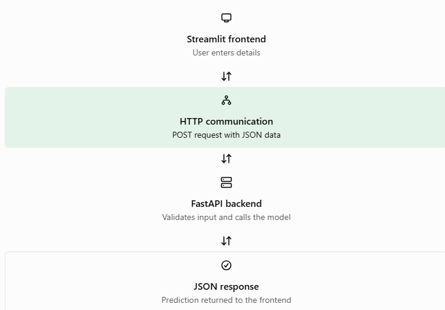

## Insurance Premium Category Predictor

Machine Learning | FastAPI | Streamlit

A beginner-friendly project demonstrating how to build a machine learning model in Google Colab, create an API using FastAPI, and connect it to a Streamlit frontend.

## Project Workflow

Part 1: Model Building

Build and train the ML model using Google Colab.

Apply feature engineering and preprocessing to user inputs.

Export the trained model as model.pkl for predictions.

Part 2: API Development

Create a REST API endpoint using FastAPI.

Receive user inputs and pass the required features to the trained model.

Return the prediction as a JSON response.

Part 3: Frontend Development

Create a simple frontend using Streamlit.

Send user inputs to the API using HTTP POST requests.

Display the predicted insurance premium category.

Real-world alternative: HTML, CSS, and JavaScript can be used to build the frontend and communicate with the FastAPI backend.

## Tech Stack

Python

Google Colab

Pandas and Scikit-learn

FastAPI

Streamlit

Requests and Pydantic

## Project Files

fastapi-ml-model.ipynb – ML model building and training

model.pkl – Exported trained model

app.py – FastAPI backend

frontend.py – Streamlit frontend

requirements.txt – Project dependencies

## Run the Project

Install dependencies:

pip install -r requirements.txt

Start the FastAPI server:

uvicorn app:app --reload

Open another terminal and run the frontend:

streamlit run frontend.py

## Application Workflow

The diagram below illustrates how the Streamlit frontend communicates with the FastAPI backend to generate and return an ML prediction.

Learning Outcome

Understanding how to build a machine learning model, create an API endpoint, and establish communication between a frontend and backend.

Author: Mansi Yadav
